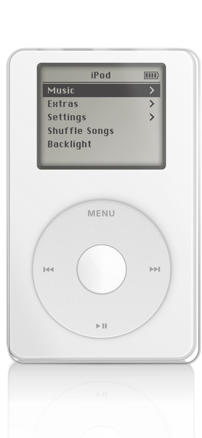
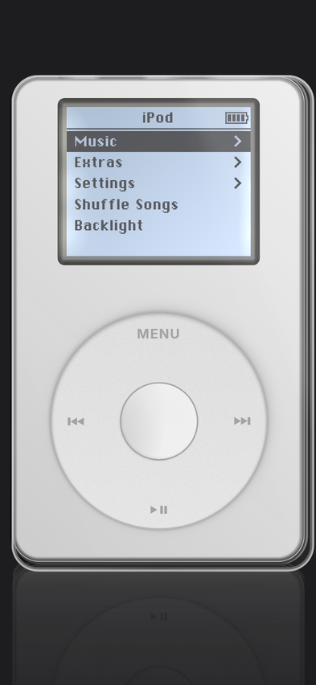
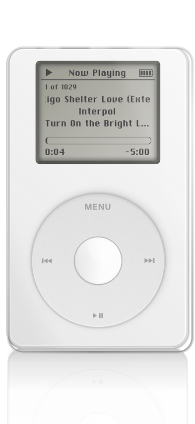

# iPod (4th generation) for Spotify

A pixel-faithful recreation of the interactive iPod from Apple Music's 404 page
(`music.apple.com/404`), redrawn as the 2004 **4th‑generation iPod** with the
single-disc Click Wheel, and wrapped in an iOS app that is a skin for **your
Spotify account**: it browses your playlists, artists, albums and liked songs and
plays them through Spotify.

| Light | Dark | Now Playing |
| --- | --- | --- |
|  |  |  |

## What it does

- **Looks and sounds like the original.** The shell, LCD tint, blue backlight with
  its nine edge-LED hot spots, Chicago screen font, menu scrollbar, title-bar
  battery, Now Playing layout, wheel acceleration curve and the clicker sound are
  all taken from Apple's page. The wheel is the 4G Click Wheel: one flat disc with
  `MENU ⏮ ⏭ ⏯` printed on it and a white centre button.
- **4G firmware menus.** iPod → Music (Playlists, Artists, Albums, Songs), Extras
  (Clock, Games → Brick), Settings (About, Shuffle, Repeat, Backlight Timer,
  Clicker, Spotify, Reset All Settings), Shuffle Songs, Backlight, Now Playing.
- **Spotify playback.** Select a song and it plays in Spotify. Scroll the wheel on
  Now Playing for volume, press the centre to scrub, hold ⏮/⏭ to skim, ⏯ to
  pause. Shuffle and Repeat in Settings drive Spotify's modes.
- **Brick.** Extras → Games → Brick (or hold the centre button for five seconds on
  the About screen). The ball ghosts like a passive-matrix LCD.
- Hold **MENU** to toggle the backlight. Menus jump back to Now Playing after ten
  idle seconds while music plays, like the firmware.

## Requirements

- Xcode 16 or newer, iOS 17 or newer.
- The **Spotify app** installed on the phone (playback goes through it via
  Spotify's App Remote SDK).
- A Spotify account. Free works for play/pause/skip through the Spotify app.
  **Premium** additionally lets the iPod start a playlist or album from any track
  and control playback when the Spotify app is not running (Spotify Connect).

## Setup

1. Go to the [Spotify developer dashboard](https://developer.spotify.com/dashboard)
   and create an app.
   - Redirect URI: `ipod-spotify://callback`
   - iOS app bundle ID: whatever you set as `PRODUCT_BUNDLE_IDENTIFIER` below.
   - APIs used: Web API, iOS SDK.
2. Open `Config.xcconfig` and set `SPOTIFY_CLIENT_ID`, `PRODUCT_BUNDLE_IDENTIFIER`
   and `DEVELOPMENT_TEAM` (your Apple team ID).
3. Open `iPod.xcodeproj`. Xcode resolves the `SpotifyiOS` package from
   `github.com/spotify/ios-sdk` on first open.
4. Run on a device (the Spotify app is not available in the simulator).
5. On the iPod go to **Settings → Spotify → Sign In**. The library loads during
   the Apple-logo boot screen and is cached for the next launch.

The first time you play something, the Spotify app opens briefly to authorise
the connection and then hands back. After that the Spotify app just needs to be
running in the background.

## Controls

| Input | Action |
| --- | --- |
| Drag around the wheel | Scroll (15° per row, Fibonacci acceleration), volume on Now Playing, paddle in Brick |
| Centre button | Select · toggle scrubbing on Now Playing · launch ball |
| MENU | Back · hold one second: backlight |
| ⏮ / ⏭ | Previous / next · hold: skim 5 s, 10 s, 20 s steps |
| ⏯ | Play / pause · on a playlist or album row: play it from the top |
| Keyboard (desktop) | Arrows, Enter, Escape, `p` play/pause, `b` backlight |

## Running the UI in a browser

The iPod itself is plain HTML/CSS/JS in `Web/`. Open `Web/index.html` in a
browser (Chromium or Safari) and it runs against a mock Spotify library, which
is how the UI was developed and screenshotted.

## How it is built

```
Web/                 the iPod (served inside the app at ipod://app/)
  css/ipod.css       device chrome, screen, menus, 4G click wheel
  js/wheel.js        rotation / tap / long-press gesture engine
  js/app.js          navigation, settings, Now Playing, playback glue
  js/screens.js      the 4G menu tree
  js/brick.js        Brick with the LCD response model
  js/clicker.js      clicker (Web Audio in browsers, native in the app)
  js/bridge.js       promise-based channel to native; mock-spotify.js fills in on the web
iPod/                SwiftUI host
  IPodWebView.swift  WKWebView + custom scheme handler for the bundle
  WebBridge.swift    JS ↔ Swift messages
  SpotifyAuth.swift  Authorization Code + PKCE, tokens in the Keychain
  SpotifyWebAPI.swift / LibraryStore.swift   library (cached on disk)
  SpotifyRemote.swift     App Remote (the Spotify app on this phone)
  PlaybackController.swift  App Remote first, Spotify Connect as fallback
  SystemServices.swift    system volume, haptics, clicker, open Spotify
```

The playback model: App Remote gives live player state and works for every
account; the Web API's player endpoints are used for "play this context from
track N" and as a fallback when the Spotify app is not connected. The volume
bar sets the system volume. Each wheel detent plays the clicker through an
ambient audio session (so it mixes with the music) with a light haptic.

## Asset provenance

`Web/assets/fonts/ChicagoKare.woff2`, `Web/assets/img/noise.png`,
`iPod/click.wav` and the pixel-art Apple logo / sad-iPod SVGs were extracted from
Apple's publicly served `web-music-ipod.esm.js` (see `tools/extract-assets.py`).
Apple and iPod are trademarks of Apple Inc.; Spotify is a trademark of Spotify
AB. This is a personal, non-commercial homage and is not suitable for App Store
distribution as-is.
